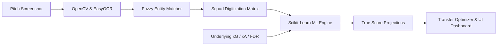

<div align="center">

# ⚽ FPL AI Assistant v2
### Computer Vision Pitch Digitization & Machine Learning Predictive Engine

[](https://github.com/TwoBytesLabs/fpl-ai-assistant)
[](https://github.com/TwoBytesLabs)
[]()
[]()
[]()

<br />

A full-stack sports analytics platform that bridges raw image processing and predictive machine learning to automate squad evaluation, identify high-upside differentials, and expose 15+ unrestricted REST APIs for Fantasy Premier League developers.

</div>

---

### 📊 Project Status & Operational Lifecycle

```
Lifecycle : Completed & Production-Ready (v2.0)
Workflow  : Active Season Maintenance & Continuous Gameweek Ingestion
Core Stack: Python 3.10+ (FastAPI) | React (Vite) | OpenCV | Scikit-Learn
```

- **Subsystem Health:**
  - `[ONLINE]` **Spatial Pitch Vision Engine:** Automatically digitizes 15-player squads directly from mobile/web screenshots via EasyOCR, OpenCV spatial coordinate clustering, and rapid Levenshtein fuzzy matching.
  - `[ONLINE]` **In-Memory ML Regressor:** Proprietary `RandomForestRegressor` analyzing multi-gameweek underlying metrics (xG, xA, Threat, Creativity, ICT Index, and Fixture Difficulty) to project true expected points.
  - `[ONLINE]` **Dynamic Transfer Optimizer:** Automated chip detection (Wildcard / Free Hit override), budget heatmap allocation, and differential suggestions based on fixture swings.
  - `[ONLINE]` **High-Concurrency API Hub:** 15+ normalized REST endpoints with fast in-memory caching and zero third-party rate limits.
- **Ongoing Season Workflow:**
  - 🔄 Matchday live points and bonus-point telemetry sync.
  - 🔄 Daily price rise/fall trend monitoring.
  - 🔄 Rolling model retraining based on team form shifts and player fitness alerts.

---

### 🧠 End-to-End Pipeline



1. **Zero-Friction Ingestion:** Instead of manual 15-man roster entry, users upload a pitch screenshot. Spatial vision clusters players into formations (Goalkeeper, Defense, Midfield, Forward) with automatic captain and chip detection.
2. **True Value Projections:** Strips away noisy surface-level historical totals, weighting underlying chance creation, minutes consistency, and fixture momentum to uncover hidden differentials.
3. **Interactive Visual Triage:** Real-time budget distribution charts, spending heatmaps, and fixture difficulty boards provide instant team diagnostics.

---

### 🌐 Developer REST API Hub
The FastAPI backend exposes 15+ endpoints running on `http://localhost:3001`:

| Category | Endpoint | Method | Functionality |
|---|---|---|---|
| **Core Ingestion** | `/api/process-team` | `POST` | Process pitch screenshot via OCR & compute ML transfer plan |
| | `/api/process-team/{id}` | `GET` | Retrieve asynchronous analysis status and recommendations |
| | `/api/metadata` | `GET` | Active gameweek state and Fixture Difficulty Rating (FDR) tables |
| **Player Database** | `/api/v2/players` | `GET` | Normalized directory of all Premier League players |
| | `/api/v2/players/{id}` | `GET` | In-depth historical match metrics and performance indices |
| **Market Intelligence** | `/api/v2/market/price-changes` | `GET` | Daily price risers and fallers |
| | `/api/v2/market/transfers-in` | `GET` | Top 20 trending acquisitions |
| | `/api/v2/market/transfers-out` | `GET` | Top 20 trending drops |
| **Live Matchday** | `/api/v2/fixtures/live` | `GET` | Live matchday scorelines and real-time bonus point calculations |
| | `/api/v2/injuries` | `GET` | League-wide injury, illness, and suspension statuses |
| **ML Projections** | `/api/v2/stats/xg-xa` | `GET` | Underlying Expected Goals (xG) and Expected Assists (xA) data |
| | `/api/v2/ml/projections` | `GET` | Raw Random Forest predictions for top 100 players |
| | `/api/v2/system/health` | `GET` | Model training status, cache latency, and telemetry |

---

### ⚡ Quick Start

#### One-Command Launch:
Run both backend microservice and client frontend simultaneously:
```bash
python3 start_all.py
```

#### Individual Component Setup:

**Backend (Port 3001):**
```bash
cd backend
python3 -m pip install -r requirements.txt
uvicorn main:app --port 3001 --reload
```

**Frontend (Port 5173):**
```bash
cd frontend
npm install
npm run dev
```

---

<div align="center">
<sub>Engineered by <b>Hriday Patel</b> • Maintained by <b>TwoBytesLabs</b></sub>
</div>
